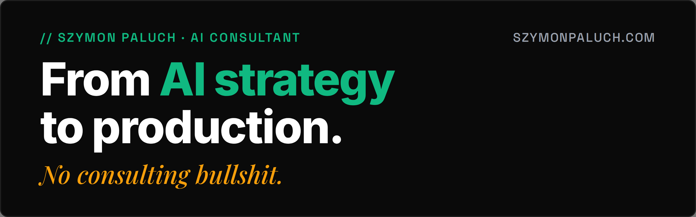
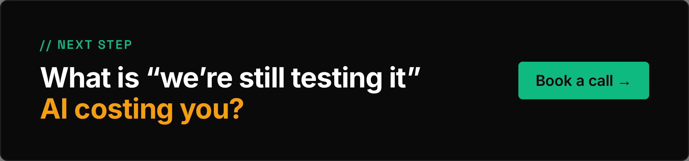

  
  
  
  
  
  

I'm an ex-CTO and AI consultant. I build AI agents and systems that survive the demo and run in production, for funded startups and enterprises.

Before that I co-founded Riot Agency, a digital agency later acquired by Diagnostyka, Poland's largest lab network. I was CTO of uPacjenta and Head of Strategy &amp; Product at Golem Network.

I work on Claude (Claude Code, the Agent SDK, the API and MCP) and on OpenAI models.

## Work with me

<table>
<tr>
<th width="50%" align="left">For companies</th>
<th width="50%" align="left">For AI consultants</th>
</tr>
<tr>
<td valign="top"><a href="https://szymonpaluch.com/implementation?utm_source=github&utm_medium=readme"><b>Implementation</b></a>: AI agents, RAG and automations, from idea to production.</td>
<td valign="top"><a href="https://szymonpaluch.com/claude-certification-practice-exams?utm_source=github&utm_medium=readme"><b>Claude certification practice exams</b></a>: five free mock exams, 306 original questions, no account.</td>
</tr>
<tr>
<td valign="top"><a href="https://szymonpaluch.com/consulting?utm_source=github&utm_medium=readme"><b>Consulting</b></a>: AI strategy, AI audits and execution oversight.</td>
<td valign="top"><a href="https://szymonpaluch.com/certified-ai-consultant-program?utm_source=github&utm_medium=readme"><b>Certified AI Consultant Program</b></a>: prepare for the Claude certifications with other consultants.</td>
</tr>
<tr>
<td valign="top"><a href="https://szymonpaluch.com/workshops?utm_source=github&utm_medium=readme"><b>Workshops</b></a>: Enterprise Agentic AI Masterclass, two days hands-on, up to 12 people.</td>
<td valign="top"><a href="https://szymonpaluch.com/newsletter?utm_source=github&utm_medium=readme"><b>The Agentic Architect</b></a>: my weekly newsletter.</td>
</tr>
<tr>
<td valign="top"><a href="https://szymonpaluch.com/speaking?utm_source=github&utm_medium=readme"><b>Speaking</b></a>: keynotes and talks on AI. Concrete, no hype.</td>
<td valign="top"><a href="https://github.com/hculap/awesome-ai-gtm"><b>awesome-ai-gtm</b></a>: AI agents and tools for building go-to-market funnels.</td>
</tr>
<tr>
<td valign="top">
 
Not sure yet? <a href="https://szymonpaluch.com/assessment?utm_source=github&utm_medium=readme">Check your AI readiness first</a>: 12 questions, 4–5 minutes.
</td>
<td valign="top">
 
Free, questions in English.
</td>
</tr>
</table>

## Open source

| Project | Language | Stars | Forks |
| :-- | :-: | :-: | :-: |
| [**awesome-ai-gtm**](https://github.com/hculap/awesome-ai-gtm): a curated list of AI agents and tools for building go-to-market funnels |  |  |  |
| [**workflow-studio**](https://github.com/hculap/workflow-studio): a no-code builder and observability dashboard for Claude Code Workflow runs |  |  |  |
| [**claude-certified-architect-practice-exam**](https://github.com/hculap/claude-certified-architect-practice-exam): 60 original questions, study and exam modes |  |  |  |
| [**better-code**](https://github.com/hculap/better-code): Claude Code plugins for code quality and developer productivity |  |  |  |
| [**emodul**](https://github.com/hculap/emodul): a local CLI and MCP server for TECH / eModul.pl floor-heating controllers |  |  |  |

## Credentials

- [**Claude Certified Architect – Foundations**](https://www.credly.com/badges/4dc5dab3-1196-410e-956d-5c316d9123eb/public_url): Anthropic certification for solution architects, score 833/1000. Verifiable on Credly.
- [**Claude Partner Badge – Claude Code**](https://www.credly.com/badges/eb278d58-1f2c-4fe2-9fa4-83f20c5bb115/public_url): Anthropic course badge, eight courses and a capstone.
- [**OpenAI Select Partner**](https://szymonpaluch.com/blog/posts/openai-select-partner?utm_source=github&utm_medium=readme): my company's status in the OpenAI Partner Network.

## Latest writing

<!-- BLOG-POST-LIST:START -->
- [An agent for everything, or an agent per project](https://szymonpaluch.com/blog/posts/one-agent-per-project?utm_source=github&utm_medium=readme) · 26 Nov 2026
- [AI and wellbeing at work: the rollout decides](https://szymonpaluch.com/blog/posts/ai-wellbeing-at-work?utm_source=github&utm_medium=readme) · 19 Nov 2026
- [The client wanted an agent on its website. The problem was in the sales team](https://szymonpaluch.com/blog/posts/website-agent-or-sales-team?utm_source=github&utm_medium=readme) · 19 Nov 2026
- [Claude exams from 7 December 2026: what changes, and Developer Professional](https://szymonpaluch.com/blog/posts/claude-exam-changes-december-2026?utm_source=github&utm_medium=readme) · 18 Nov 2026
- [Claude exams cost $0 until 30 November 2026: who qualifies and how to book](https://szymonpaluch.com/blog/posts/free-claude-exams-november-2026?utm_source=github&utm_medium=readme) · 18 Nov 2026<!-- BLOG-POST-LIST:END -->

[All posts on the blog →](https://szymonpaluch.com/blog/?utm_source=github&utm_medium=readme)

## Talks

- **WaysConf 2026**, Kraków, 16–17 September: masterclass “Build an AI that checks and fixes its own work: agentic loops in practice”. [Workshop code](https://github.com/hculap/waysconf-2026-agentic-loops).
- **WebX Tokyo 2024**: speaker.

Looking for a speaker on AI in production? See [Speaking](https://szymonpaluch.com/speaking?utm_source=github&utm_medium=readme).

## Toolbox

 

No salesperson, no slides. You walk me through the problem and I tell you straight whether I have a sensible way to solve it and what it really costs.
